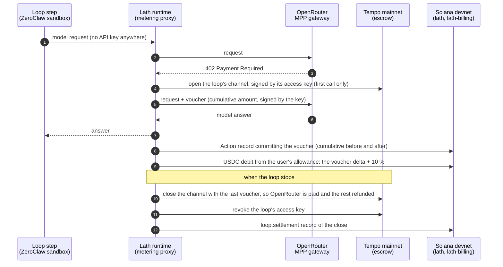
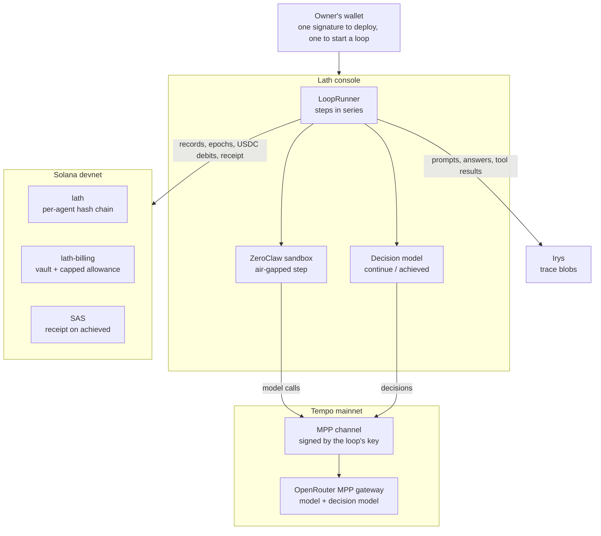

# Lath

**Agent loops that pay for their own AI on Tempo, with a record of every payment anyone can replay on Solana.**
Lath is for teams that run agents on their users' behalf. Each loop pays OpenRouter for every model call over a Tempo
MPP payment channel, signed in the demo by the loop's own access key whose USDC.e limit Tempo itself enforces. Every
one of those calls is also a record on Solana that commits its payment, so a user can check what their agent did with
the money without taking the operator's word. The user's side is a capped USDC allowance approved once on Solana, and
a second model, not the agent, decides when a goal loop is done.

[Demo video](https://youtu.be/Kqe1J-I7yO4) · [Evidence page](https://getlath.xyz/evidence) · [getlath.xyz](https://getlath.xyz)

Lath runs on **Solana devnet** (records and the USDC allowance) and **Tempo mainnet** (model payments, in small
amounts of real USDC.e). There is no hosted console: it runs on the operator's machine. A hosted private beta is
planned and not open.

## What you can ask

A loop answers a question about a Solana protocol from sources pinned before it starts: the code at a commit and the
program's accounts at a slot. Each claim cites its file, and the evidence page links every file, step and payment. The
filmed run asks: _Before I approve a Squads transaction, who can upgrade this program, and what does each instruction
that moves funds check?_ Questions about activity over time, such as usage in the last 30 days, do not fit yet.

## Lath on Tempo

Tempo is where Lath's agents pay. The console holds no model API key: a loop's agent reaches OpenRouter only through
its MPP gateway, and pays for each call as it makes it.

- **A channel per loop, a voucher per call.** The loop opens one MPP channel to OpenRouter's gateway on Tempo mainnet
  and signs a voucher for each model call. The voucher's delta is what the call cost, and it is the meter: it sets
  the user's USDC debit on Solana (the delta plus 10 %) and is committed in the call's record. →
  [ARCHITECTURE §7.2](docs/ARCHITECTURE.md#72-tempo-mpp) · [`runtime/src/transport/mpp.ts`](runtime/src/transport/mpp.ts)
- **A spending limit Tempo enforces.** Each loop's channel is signed by its own Tempo access key, authorized for the
  loop's budget plus Lath's 15 % decision share (1.15 USDC.e for a 1 USDC loop) and revoked when the loop stops. A
  payment past it is refused by Tempo, not by Lath's code. The loop's signed policy commits the key. →
  [ARCHITECTURE §7.3](docs/ARCHITECTURE.md#73-per-loop-access-keys) ·
  [`frontend/src/app/api/_lib/tempo-keys.ts`](frontend/src/app/api/_lib/tempo-keys.ts)
- **Settled when the loop stops.** The channel closes on Tempo with the last voucher, and the escrow refunds the rest.
  The decision model is paid over the same channel, by Lath, and each step's report is stored on Tempo storage and
  paid per write. → [ARCHITECTURE §7.4](docs/ARCHITECTURE.md#74-tempo-storage-and-rpc) ·
  [`runtime/src/loop-tempo.ts`](runtime/src/loop-tempo.ts)
- **Every payment bound to a record.** A model call's Action record on Solana commits the voucher that paid for it, so
  the payment and the action it paid for are checked together. `lath-audit verify-channel` adds up the chain's
  vouchers and holds them to what the channel settled on Tempo, and the loop's access key to what its policy committed.
  → [Check it yourself](#check-it-yourself)

One paid call, end to end ([ARCHITECTURE §7.2](docs/ARCHITECTURE.md#72-tempo-mpp)):



**Running on Tempo mainnet now.** From 2026-09-16 to 2026-10-12 the operator's treasury,
[`0x18fB…e0B0`](https://explore.tempo.xyz/address/0x18fBE5E0A83DCA440072059F91D1a23BaBE6e0B0), has opened 390 MPP
channels and settled 389, paying 4.076 USDC.e to MPP services: OpenRouter's gateway for model calls, and 31 writes to
Tempo storage. All of it was paid for agents and loops the Lath team ran on devnet; there are no outside users yet.
The figures come from Tempo's own records, and anyone can read them again:
`npm run -s tempo:stats -- --address 0x18fBE5E0A83DCA440072059F91D1a23BaBE6e0B0`
([`frontend/src/app/api/_lib/tempo-stats.ts`](frontend/src/app/api/_lib/tempo-stats.ts)), and the console serves them
at `GET /api/tempo/stats`.

MPP gateways for language models already exist, and Tempo already offers spending limits. What we have not found
elsewhere is the combination: unattended agent loops that pay for their own model calls from a key Tempo caps per loop,
with each payment tied to a record anyone can replay.

### Tempo features used

- **MPP sessions.** One TIP-1034 payment channel per loop to OpenRouter's MPP gateway, on the escrow at
  `0x4d50…0000`, and one cumulative voucher per call, signed through `mppx` (`tempo.session.manager`).
- **MPP charges.** One TIP-20 transfer per call to Tempo's storage gateway, fee sponsored, with an attribution memo
  that names the loop when it has its own key.
- **Access keys.** Each loop's key is authorized on the treasury's AccountKeychain with a USDC.e limit and an expiry,
  its limit is reset before a reopen, and it is revoked at the stop. Call scopes (the escrow's `open` and `topUp`, and
  USDC.e `transferWithMemo` to the storage payee) are built, and were off in the demo, pending their mainnet probe.
- **Fee sponsorship.** The gateway sponsors the channel open and the payee sends the close, so a session costs the
  treasury no gas.
- **USDC.e** (TIP-20 `0x20c0…8b50`) on Tempo mainnet, chain 4217.
- **Tempo services over MPP:** OpenRouter's chat and decisions endpoints, storage (`storage.mpp.tempo.xyz`) and the
  paid RPC (`rpc.mpp.tempo.xyz`).
- **Tempo's public reads:** the escrow's and the keychain's logs over `rpc.tempo.xyz`, the `api.tempo.xyz` activity
  feed, and links to explore.tempo.xyz.

### Tempo in the code

Each stage of a paid call, the Tempo primitive it uses, where it is, and the suites in `tests/` that pin it. Every one of
these suites is node-only: no chain, no key and no network.

| Stage                                                 | Tempo primitive                                                                                   | Code                                                                                                                                                                                                  | Tests                                       |
| ----------------------------------------------------- | ------------------------------------------------------------------------------------------------- | ----------------------------------------------------------------------------------------------------------------------------------------------------------------------------------------------------- | ------------------------------------------- |
| A model call: the 402, the channel, one voucher       | MPP session, a TIP-1034 channel                                                                   | [`runtime/src/transport/mpp.ts`](runtime/src/transport/mpp.ts) `MppOpenRouterTransport.chat`                                                                                                          | `tempo-inference`, `tempo-ledger`           |
| The decision model, paid on the same channel          | `openrouter.mpp.tempo.xyz/alpha/decisions`                                                        | [`runtime/src/transport/mpp.ts`](runtime/src/transport/mpp.ts) `MppOpenRouterTransport.decide`                                                                                                        | `tempo-inference`, `loop-goal-check`        |
| One channel per loop: opened, carried, settled        | the escrow's open, top-up and close                                                               | [`frontend/src/app/api/_lib/loop-channel.ts`](frontend/src/app/api/_lib/loop-channel.ts) `openLoopChannel`, `settleLoopChannel`                                                                       | `console-loops`, `console-loop-settle-slot` |
| A spending limit Tempo enforces, per loop             | AccountKeychain: `accessKey.authorize`, `updateLimit`, `revoke`, `getRemainingLimit` (`viem/tempo`) | [`frontend/src/app/api/_lib/tempo-keys.ts`](frontend/src/app/api/_lib/tempo-keys.ts) `createLoopKey`, `authorizeLoopKey`, `reconcileLoopKeyLimit`, `revokeLoopKey`                                   | `tempo-keys`, `loop-tempo-key`              |
| The voucher delta becomes the USDC debit on Solana    | the voucher's cumulative amounts                                                                  | [`runtime/src/runtime.ts`](runtime/src/runtime.ts) `recordLlmStep`, [`runtime/src/billing.ts`](runtime/src/billing.ts) `toMicroUsdcFromBase`                                                          | `runtime-budget`, `tempo-verify`            |
| Each step's report stored, paid per write             | MPP charge, one TIP-20 transfer                                                                   | [`runtime/src/loop-tempo.ts`](runtime/src/loop-tempo.ts) `LoopTempoServices`, [`runtime/src/transport/mpp.ts`](runtime/src/transport/mpp.ts) `MppChargeTransport`                                    | `tempo-storage`, `tempo-verify-charge`      |
| The runtime's own Tempo reads                         | MPP session to `rpc.mpp.tempo.xyz`                                                                | [`runtime/src/transport/mpp.ts`](runtime/src/transport/mpp.ts) `MppRpcSession`                                                                                                                        | `tempo-snapshot`                            |
| The audit: vouchers against the settlement, the key against the policy | the escrow's `ChannelOpened` and `ChannelClosed`, the keychain's `KeyAuthorized` and `SpendingLimitUpdated` in the authorize transaction | [`sdk/src/audit/channels.ts`](sdk/src/audit/channels.ts) `verifyChannels`, [`sdk/src/audit/keys.ts`](sdk/src/audit/keys.ts), [`sdk/src/tempo.ts`](sdk/src/tempo.ts)                    | `tempo-verify`                              |
| The browser's check of a settlement                   | the `ChannelClosed` the escrow emitted for this channel                                           | [`frontend/src/lib/tempo-close.ts`](frontend/src/lib/tempo-close.ts) `closeReceiptProblem`                                                                                                            | `tempo-close`, `tempo-close-several`        |
| What the treasury has paid                            | the `api.tempo.xyz` activity feed, the escrow's `getChannelState`                                 | [`frontend/src/app/api/_lib/tempo-stats.ts`](frontend/src/app/api/_lib/tempo-stats.ts) `classify`, `summarize`                                                                                        | `tempo-stats`                               |

### What we learned building on Tempo

- **A channel deposit counts against an access key's limit.** The escrow's pull is limited, and a deposit past the
  limit is refused with `SpendingLimitExceeded`, on mainnet as in Tempo's source. That is what lets Tempo, not Lath,
  cap a loop ([`scripts/tempo-access-key-probe.ts`](scripts/tempo-access-key-probe.ts) is the mainnet probe).
- **A session costs the payer no gas.** The gateway sponsors the open (`feePayer: true`) and the payee sends the
  close, so the treasury moves by exactly the vouchers: 9 000 base units for six calls at 1 500, measured.
- **The keychain has no spent counter, and `KeyAuthorized` carries no limit.** Neither `getKey` nor `viem`'s
  `getMetadata` says what a key has spent, so it has to be derived from the limit in force and `getRemainingLimit`.
- **`ox` groups a key's scopes by the address string, and an empty recipient list means anyone.** Lath lower-cases
  every scope and refuses an empty list, rather than authorize a key wider than it reads.
- **A closed channel reads as zeros.** `getChannelState` says what an open channel still holds, not what a closed one
  paid, so the treasury's figures come from the activity feed and the escrow read only separates money paid from money
  still parked.
- **`mppx` retries a refused paid charge up to three times, each one a new transfer.** Lath's charge client sets
  `maxPaymentRetries: 1`, so a refused credential is recorded as refused, not bought twice.
- **One settlement transaction can close several channels.** The browser's close check finds this channel's
  `ChannelClosed` among every one the escrow emitted on the receipt.
- **`mppx` stores the signed cumulative before the request it pays for goes out.** Lath reports every write to that
  store, the one moment the console learns both the channel and the amount in time to survive a kill mid-call.

## Where to start

This page is the whole project in one read. Each section is short and ends in links to the detail: the docs by
section, and the code by file.

1. **Watch the [demo video](https://youtu.be/Kqe1J-I7yO4)**: an agent is deployed, runs a goal loop in the sandbox, is stopped by the
   decision model, gets a receipt on SAS, and is audited.
2. **Read [Lath on Tempo](#lath-on-tempo) above, with [Tempo in the code](#tempo-in-the-code), then [the idea](#the-idea)
   and [the picture](#how-it-fits-together)** below.
3. **Open the [evidence page](https://getlath.xyz/evidence)**: every fact of the filmed run, each linked to Solana's or
   Tempo's explorer. What is deployed and live is in [Development and proof](#development-and-proof).
4. **Re-run the audit** from a clone, with no access to the operator's machine: [Check it yourself](#check-it-yourself).

On this page: [Lath on Tempo](#lath-on-tempo) · [The idea](#the-idea) · [How it fits together](#how-it-fits-together) · [The pieces](#the-pieces) ·
[How a loop is paid](#how-a-loop-is-paid) · [Check it yourself](#check-it-yourself) ·
[What it does not claim](#what-it-does-not-claim) · [Run it locally](#run-it-locally) ·
[Development and proof](#development-and-proof) · [Repository layout](#repository-layout) ·
[Documentation map](#documentation-map)

## The idea

A team that runs agents for its users has to answer two questions: how much can the agent spend, and what did it do
with the money. Lath answers both with public records rather than with the operator's word.

- **The bound is on chain.** The user approves a capped, expiring USDC allowance once, and the `lath-billing` program
  refuses any debit past it. With per-loop keys, Tempo itself refuses any payment past the loop's budget plus Lath's
  decision share.
- **The record is on chain.** Every model call, tool call and loop step is a record in the agent's own hash chain on
  Solana, and each model call's record commits the Tempo voucher that paid for it.
- **The stop is not the agent's.** A goal loop ends when a second model, the decision model, answers _achieved_ at a
  bar the loop's signed terms fixed. The agent saying it is done is not enough.

## How it fits together



A run, as the demo films it, after the owner has deposited USDC into the vault on `/billing`:

1. **Deploy an agent.** The wallet signs one transaction: the console funds the agent's key and registers it, and the
   wallet approves the allowance. The person pays no SOL. →
   [ARCHITECTURE §7.5](docs/ARCHITECTURE.md#75-the-usdc-allowance-on-solana)
2. **Start a goal loop.** From the agent's page, one `"Lath loop"` message signature binds the loop's terms: the goal,
   the budget, the steps and interval, the sources it reads (pinned on Irys at the start), the verify bar and the
   receipt. A new agent can also carry its loop in its deploy (_Create_ → _Agent loop_ → _New_), so one transaction
   registers it and starts the loop, without sources or a receipt. → [ARCHITECTURE §4.2](docs/ARCHITECTURE.md#42-a-loop) · [SPEC §3.1](SPEC.md#31-lifecycle-records)
3. **The steps run in the sandbox.** Each step reads its pinned sources, calls the model over Tempo, and closes with
   its checkpoint on Solana. The loop page shows each paid call beside its record, and the open channel filling. →
   [ARCHITECTURE §5](docs/ARCHITECTURE.md#5-loops-in-the-sandbox) · [§7.2](docs/ARCHITECTURE.md#72-tempo-mpp)
4. **The decision model answers _achieved_.** The step is written with status 201 (goal reached), the loop stops, and
   its Tempo channel settles. → [ARCHITECTURE §6](docs/ARCHITECTURE.md#6-the-decision-model)
5. **The receipt is published** on SAS, pointing at that last record. →
   [ARCHITECTURE §8](docs/ARCHITECTURE.md#8-sasreceipt)
6. **The audit.** `lath-audit` replays the chain from Solana and Irys, and checks the receipt and the decision behind
   the stop. → [Check it yourself](#check-it-yourself)

## The pieces

Each piece in one or two sentences, then where to read more and where the code is.

### Record: what the agent did

- **Agent hash chain on Solana.** Each event is a 147-byte Light Protocol ZK-compressed account, which costs no rent,
  folded into the agent's head:
  `head_n+1 = sha256(head_n ‖ agent_id ‖ seq ‖ timestamp ‖ kind ‖ status ‖ reference ‖ payload_hash)`. Four kinds
  cover a session: Genesis, Action (one per model or tool call), Delegation and Resolution. Only the agent's authority
  key can append. → [SPEC §4.4](SPEC.md#44-hash-chain) · [ARCHITECTURE §2.1](docs/ARCHITECTURE.md#21-lath-the-hash-chain)
  · [`programs/lath`](programs/lath/src/lib.rs)
- **Epochs.** A session's model and tool calls become the leaves of one Merkle root, anchored in one write, so a loop
  step costs about 70 000 lamports to anchor however many calls it made. →
  [SPEC §15](SPEC.md#15-epochs) · [ARCHITECTURE §11 Cost](docs/ARCHITECTURE.md#11-cost) ·
  [`sdk/src/rollup.ts`](sdk/src/rollup.ts)
- **Public traces on Irys.** Prompts, completions and tool results are content-addressed blobs. The chain commits their
  SHA-256, an on-chain locator map says where each lives, and the reader fetches the bytes from a public gateway and
  re-hashes them. The console writes every blob in the clear. →
  [ARCHITECTURE §9](docs/ARCHITECTURE.md#9-traces-and-data-availability) ·
  [SPEC §14](SPEC.md#14-locators-published-names-and-what-an-auditor-needs) ·
  [`sdk/src/trace-store.ts`](sdk/src/trace-store.ts) · [`sdk/src/locator.ts`](sdk/src/locator.ts)
- **Lifecycle records.** An agent's deploy and a loop's start, pause, resume and stop are records on its chain, each
  carrying the owner's own wallet signature, with public documents on Irys. A loop's first step waits for its start to
  land, the status on screen is the one the chain records, and a console that loses its state directory rebuilds its
  agents and loops from the chain, read-only. → [SPEC §3.1](SPEC.md#31-lifecycle-records) ·
  [`sdk/src/lifecycle.ts`](sdk/src/lifecycle.ts)

### Pay: what it may spend

- **Capped USDC allowance.** The owner deposits USDC into the `lath-billing` vault, and deploying an agent approves a
  capped, expiring allowance in the same transaction that registers it; no run asks for another signature. →
  [ARCHITECTURE §7.5](docs/ARCHITECTURE.md#75-the-usdc-allowance-on-solana) ·
  [SECURITY §6](SECURITY.md#6-spend-limits) · [`programs/lath-billing`](programs/lath-billing/src/lib.rs)
- **Model payments over Tempo.** Each model call is paid through an MPP channel to OpenRouter's gateway, with no API
  key; the voucher delta is what the call cost, and the call's record commits it. →
  [ARCHITECTURE §7.2](docs/ARCHITECTURE.md#72-tempo-mpp) · [`runtime/src/transport/mpp.ts`](runtime/src/transport/mpp.ts)
- **Per-loop Tempo key.** Each loop's channel is signed by its own access key whose USDC.e limit, the loop's budget
  plus Lath's 15 % decision share, Tempo enforces; the loop's policy commits the key. →
  [ARCHITECTURE §7.3](docs/ARCHITECTURE.md#73-per-loop-access-keys) ·
  [`frontend/src/app/api/_lib/tempo-keys.ts`](frontend/src/app/api/_lib/tempo-keys.ts)
- **Step report on Tempo storage.** Each step's report is stored on Tempo and committed by a `storage.put` record. →
  [ARCHITECTURE §7.4](docs/ARCHITECTURE.md#74-tempo-storage-and-rpc) · [`runtime/src/loop-tempo.ts`](runtime/src/loop-tempo.ts)

### Decide: when it stops

- **Goal loops.** An agent steps on a schedule under one overall budget. Each step is one session and closes with an
  `Action{tool_id: "loop.step"}` checkpoint whose `result_hash` is a leaf over the chain as the step left it. →
  [ARCHITECTURE §4.2](docs/ARCHITECTURE.md#42-a-loop) · [`runtime/src/loop.ts`](runtime/src/loop.ts)
- **ZeroClaw sandbox.** Every loop step runs in a Lath-patched build of ZeroClaw, an open-source agent runtime,
  air-gapped but for two Unix sockets (the metering proxy and Lath's host tools). Its posture is committed under the
  step's policy hash before the step runs. → [ARCHITECTURE §5](docs/ARCHITECTURE.md#5-loops-in-the-sandbox) ·
  [SECURITY §4](SECURITY.md#4-the-loop-sandbox) · [`zeroclaw/`](zeroclaw) · [`runtime/src/zeroclaw`](runtime/src/zeroclaw)
- **Decision model (Jev).** After each step, TypeSafe's typed decision model answers _continue_ or _achieved_ with a
  confidence, and _achieved_ at the committed bar stops the loop. In the same call it decides whether the step's output
  is kept as the loop's memory. The answer is committed by hash in the step's checkpoint. If it does not answer, the
  check is recorded as unavailable and the agent's own claim decides. Lath pays for it, never the owner. →
  [ARCHITECTURE §6](docs/ARCHITECTURE.md#6-the-decision-model) · [`runtime/src/decide.ts`](runtime/src/decide.ts) ·
  [`sdk/src/verify.ts`](sdk/src/verify.ts)
- **Receipt on SAS.** When the loop stops on the decision model's _achieved_, the console publishes one attestation on
  the Solana Attestation Service pointing at the loop's last record: agent, loop, seq, head, step count, the goal's
  hash and what the loop cost. It is an index into the chain, not a proof of it. →
  [ARCHITECTURE §8](docs/ARCHITECTURE.md#8-sasreceipt) · [`sdk/src/receipt.ts`](sdk/src/receipt.ts) ·
  [`runtime/src/plugins/sas.ts`](runtime/src/plugins/sas.ts)

### Verify: check it without trusting the operator

- **`lath-audit`.** A CLI that replays the chain from Solana and Irys, and checks the epochs, the receipt, the Tempo
  channel and the steps, from any machine. → [SPEC §7](SPEC.md#7-verification-procedure-auditor) ·
  [ARCHITECTURE §10](docs/ARCHITECTURE.md#10-what-the-chain-proves) · [`sdk/src/cli.ts`](sdk/src/cli.ts) ·
  [`sdk/src/audit`](sdk/src/audit)
- **Evidence page.** One static page per finished loop where every record, debit, Tempo payment, receipt and pinned
  file links to its public explorer. → [`scripts/evidence`](scripts/evidence)
- **The console checks in the browser.** Every claim on screen is computed in the browser from chain data, beside the
  committed hash, the URL fetched and a `curl` + `shasum` line to repeat it. Every deploy and loop start is also saved
  as a versioned template, which _Clone_ and _Run again_ start from. →
  [ARCHITECTURE §4.3](docs/ARCHITECTURE.md#43-the-console) · [`frontend/`](frontend)

What is on the roadmap (teams, gated loops, the marketplace, owner privacy and more), and what comes next, is in
[ROADMAP.md](ROADMAP.md).

## How a loop is paid

| Who pays            | Whom, for what                                    | Where                               | Bounded by                                                       |
| ------------------- | ------------------------------------------------- | ----------------------------------- | ---------------------------------------------------------------- |
| The owner           | the operator: each call's voucher delta + 10 %    | Solana, `lath-billing` `charge`     | the allowance's cap and expiry                                   |
| Operator's treasury | OpenRouter, per model call                        | Tempo, the loop's MPP channel       | the channel's deposit and, with loop keys, a limit Tempo enforces |
| Lath                | the decision model, 40 to 75 base units a call    | Tempo, the same channel             | 15 % of the loop's budget                                        |
| The owner, metered  | Tempo storage for each step's report              | Tempo                               | the loop's budget                                                |
| Lath                | Tempo RPC, the runtime's own reads                | Tempo                               | —                                                                |

Because a step's calls are batched into an epoch, each paid call's debit is a transaction of its own, journaled ahead
of the epoch it pays for. **The two ledgers do not settle against each other yet**: the operator moves USDC from the
vault's sweepable balance to the treasury by hand, and the console's billing page shows both balances beside that
sentence. The treasury should hold the loop's budget plus Lath's decision share: 1.15 USDC.e for a 1 USDC budget. →
[ARCHITECTURE §7 Payment](docs/ARCHITECTURE.md#7-payment) · [§11 Cost](docs/ARCHITECTURE.md#11-cost)

## Check it yourself

**No install.** The [evidence page](https://getlath.xyz/evidence) for the filmed run links each step's checkpoint, the
USDC debits in the loop's window and the receipt on [Solana Explorer](https://explorer.solana.com/?cluster=devnet), and
the loop's access key, payment channel, storage payments and settlement on [Tempo's explorer](https://explore.tempo.xyz).
The operator's treasury is
[`0x18fBE5E0A83DCA440072059F91D1a23BaBE6e0B0`](https://explore.tempo.xyz/address/0x18fBE5E0A83DCA440072059F91D1a23BaBE6e0B0).

**From a clone**, with no access to the operator's machine. `@lath/sdk` is not published to npm, so `lath-audit` runs
from the repository. The filmed run is agent `squads-v4-review`, loop `loop-b37ba7c46db86bd4`: four steps, 20 paid
model calls, 0.0599 USDC charged on Solana and 0.0547 USDC.e paid on Tempo, its goal reached at the step 4 checkpoint,
seq 114, where the decision model answered achieved at 0.98. The commands below are filled in for it. With a Helius key
the plain audit takes about four minutes, and `verify-channel` and `verify-step` about two each.

```bash
git clone https://github.com/lath-agents/lath && cd lath && npm ci
R="https://devnet.helius-rpc.com/?api-key=…"   # your own ZK-compression RPC for Solana devnet
# (a free key at https://dashboard.helius.dev; api.devnet.solana.com has no compression index, so it reads nothing)

# The chain: every record replayed from Genesis to AgentState.head, every epoch opened from Irys
npm run -s audit -- --name squads-v4-review --rpc "$R" \
  --gateway https://gateway.irys.xyz --scheme 4 --encoding base64url

# The receipt on SAS, held to the loop's records
npm run -s audit -- verify-receipt --name squads-v4-review --loop loop-b37ba7c46db86bd4 --rpc "$R" \
  --gateway https://gateway.irys.xyz --scheme 4 --encoding base64url

# The decision model's answer behind the stop, re-hashed and held to the bar
npm run -s audit -- verify-step --name squads-v4-review 114 --rpc "$R" \
  --gateway https://gateway.irys.xyz --scheme 4 --encoding base64url

# The Tempo side: every voucher the chain committed, held to what the channel settled on Tempo,
# and every voucher's signer held to the loop's access key
npm run -s audit -- verify-channel --name squads-v4-review --key --rpc "$R" \
  --gateway https://gateway.irys.xyz --scheme 4 --encoding base64url
```

What `verify-channel` printed for a six-step loop the team ran on 2026-10-12 UTC (agent `agent_loop`, one channel on
Tempo mainnet, [settled here](https://explore.tempo.xyz/tx/0x23648e914291bcab8f7d9169eff52872ab6f9c5da26c4fef2e4b5aecf253eca8)):

```text
key        0x1d88db5870c9d233807c40ed4edfe307e7bb7f5a
  (a) authorized   ok: … limit 1150000 of 0x20c0…8b50 (USDC.e)
  (b) signed       ok: 1 of 1 channels opened with the key as authorizedSigner
channel    0x69ba1ab9e8e93c78350ee31bb63e274660c59e8df17dadf837380f8f083b1b68
calls      34 (seq 16, 19, 22, … 151)
vouchers   0 → 126134 (126134 USDC.e base units bought on this chain)
decisions  6 committed by the loop's checkpoints, 439 base units of the above
settled    126134
key        ok: … 34 of 34 vouchers name the key as signer

VERIFIED
```

Thirty-four model calls, each a record on Solana; their vouchers add up to exactly what the channel settled on Tempo,
and every one was signed by the loop's own key, authorized for 1.15 USDC.e. The same agent's chain, and the decision
behind its last step (its loop stopped at its six-step cap, so it has no receipt):

```bash
npm run -s audit -- --name agent_loop --rpc "$R" --gateway https://gateway.irys.xyz --scheme 4 --encoding base64url
npm run -s audit -- verify-step --name agent_loop 154 --rpc "$R" \
  --gateway https://gateway.irys.xyz --scheme 4 --encoding base64url
```

```text
seq        164 (22 records replayed)
chain      OK
epochs     6 (111 steps, all rebuilt)
traces     all retrievable (398 checked, 111 steps inside epochs)
verified   6 steps claim a verifier (6 decisions retrievable)
  what each verdict said is `verify-step <agent> <seq>`
memory     5 of 5 loop steps resumed from the memory their loop's last checkpoint committed
deploy     owner 7HtX…BbHD · deploy tx verified
loops      1 recorded: loop-95177f2… stopped (max-steps, 6 steps)

VERIFIED
```

<details>
<summary>More checks, exit codes, and chains written encrypted</summary>

The console writes every run in the clear, so each command needs only an RPC and the public Irys gateway. The plain
audit verifies every record and every epoch, and with `--require-preimages` it also re-hashes every trace. A run
written encrypted (devnet carries some) behaves differently:

- the plain audit reports its traces as encrypted rather than missing;
- `verify-receipt` and `verify-step` read the loop's step manifests, so they need the agent's trace key (64 hex
  characters, or a file of them, passed as `--trace-key`), which only the operator holding the console's server
  keypair can derive; no console route hands it out;
- without the key, those two report the manifests as not readable and end `NOT VERIFIED`.

The plain audit exits `0` verified, `1` the chain does not replay, `2` traces or epoch blobs missing or disagreeing,
`3` bad arguments, `4` not checked. `verify-receipt` and `verify-step` exit `0` verified, `1` a contradiction, `2`
nothing to check or a reader that did not answer.

</details>

→ [SPEC §7 Verification procedure](SPEC.md#7-verification-procedure-auditor) ·
[ARCHITECTURE §10 What the chain proves](docs/ARCHITECTURE.md#10-what-the-chain-proves)

## What it does not claim

- **Truth and availability.** The chain proves what an agent recorded, and that nothing changed since. It does not
  prove the record was true of the world, and it does not make a store keep its bytes: a blob that is gone is reported
  missing, never hidden. The demo's blobs are on Irys devnet, which keeps them for about sixty days.
- **That the decision was right.** The decision model's answer is committed, so an audit can show which model said what
  about which state, and that the loop acted on it by its own rule. It does not show the answer was right.
- **Atomic payment.** The model is paid on Tempo before the event is anchored on Solana: the payment is committed by
  the record and checkable on Tempo, not atomic with it. On Solana the program holds each USDC debit to the cap but does
  not bind it to the record it pays for, and a call batched into an epoch, as every call in a loop is, is charged in a
  transaction no record names, so nothing yet checks that debit against its voucher beyond the cap.
- **No server holds the user's key, but the console holds its own.** What leaves the browser is a signature. An agent
  deployed through the console is registered with a key the console derives from its own, because only the registering
  key can append; that key can write the agent's chain and charge against the cap its owner approved, never raise it.
  The console also holds the Tempo treasury key, which signs every channel and voucher, or authorizes each loop's key.
- **Refunds.** The vault is deposit-only: USDC leaves it only through the operator's sweep of metered spend, and closing
  an agent refunds nothing.

→ [SECURITY §1 Trust model](SECURITY.md#1-trust-model) · [SECURITY §8 Known limits](SECURITY.md#8-known-limits) ·
[ARCHITECTURE §10](docs/ARCHITECTURE.md#10-what-the-chain-proves)

## Run it locally

You need Node 20 or later, the Solana CLI, and for loops a Rust toolchain through `rustup` (the ZeroClaw build pins
its version) with `sandbox-exec` (macOS) or `bwrap` with user namespaces (Linux). Development runs against the
deployed devnet programs; there is no local validator. Five things to set up: a ZK-compression RPC, the console's
runtime key, a Tempo treasury, the patched ZeroClaw, and a devnet wallet with USDC.

<details>
<summary>Setup commands, the browser side, and the switches the demo ran with</summary>

```bash
git clone https://github.com/lath-agents/lath && cd lath
npm ci && npm --prefix frontend ci && npm run sdk:build && npm run runtime:build

# 1. A ZK-compression RPC for devnet: one url serving JSON-RPC, Photon and the prover (Helius).
#    api.devnet.solana.com has no compression index, so every agent read would come back empty.
export LATH_DEVNET_RPC="https://devnet.helius-rpc.com/?api-key=…"   # a free key at https://dashboard.helius.dev

# 2. The console's runtime key: it pays every server-side write and uploads blobs to Irys.
solana-keygen new -o frontend/.runtime-keypair.json                  # git-ignored
solana transfer --url "$LATH_DEVNET_RPC" "$(solana-keygen pubkey frontend/.runtime-keypair.json)" 1 \
  --allow-unfunded-recipient
npm run irys -- fund 0.05     # its balance at Irys devnet; or run the console with LATH_TRACE_BACKEND=fs

# 3. The Tempo treasury: a Tempo mainnet account holding a few USDC.e (keep it at or under $10).
#    Its 0x-prefixed private key in .tempo-treasury.key at the repo root (git-ignored), or LATH_TEMPO_TREASURY.
#    Without it nothing is billed: sessions run on a scripted transport and say so.

# 4. The Lath-patched ZeroClaw: upstream at a pinned commit plus zeroclaw/patches, built reproducibly.
#    Without it the console still serves the app, and refuses to start a loop.
zeroclaw/build.sh

# 5. Check what the console will use, then run it on http://127.0.0.1:3000
npm run dev:devnet -- --print
npm run dev:devnet
```

In the browser, use a wallet switched to devnet with a little devnet SOL, and devnet USDC from
[Circle's faucet](https://faucet.circle.com) (mint `4zMMC9srt5Ri5X14GAgXhaHii3GnPAEERYPJgZJDncDU`). Deposit it into
the vault from `/billing`, deploy an agent, then start a loop from its page (_Run as a loop_). The treasury should hold
the loop's budget plus Lath's decision share, which the loop's channel deposits: 1.15 USDC.e for a 1 USDC budget.

Two switches are off by default in the code and were on for the demo. `LATH_TEMPO_LOOP_KEYS=on` gives each new loop its
own Tempo access key, scoped to the loop's own calls unless `LATH_TEMPO_KEY_SCOPES=off`. `LATH_PROTOCOL_PLUGINS=on` lets
a loop start ask for the receipt on SAS; the console also needs a SAS credential and receipt schema whose issuer has
authorized its runtime key. `npm run -s demo-attest:seed` creates them (`-- --subject <program id>` is optional: it
falls back to the subjects a previous seed wrote, then the `lath` program), and
`npm run -s demo-attest:authorize -- --key <runtime key address>` adds the key. The demo's console ran with:

```bash
LATH_PROTOCOL_PLUGINS=on LATH_TEMPO_LOOP_KEYS=on LATH_TEMPO_KEY_SCOPES=off npm run dev:devnet
```

with blobs on Irys devnet, the default for a devnet console (the filmed take adds `-- --e2e`, which signs with the
Playwright suite's test wallet). `LATH_IRYS_NETWORK=mainnet` keeps blobs on Irys mainnet for one payment, in real SOL
from the runtime key's Irys balance, instead of about sixty days on devnet. Every server variable is documented at the
top of [`frontend/src/app/api/_lib/runner.ts`](frontend/src/app/api/_lib/runner.ts), and the loop scheduler's at the
top of [`frontend/src/app/api/_lib/loops.ts`](frontend/src/app/api/_lib/loops.ts). After a run,
`npm run -s evidence -- --loop <loop id>` builds a static evidence page from the console's public reads and the
explorers.

</details>

### Build and test

```bash
anchor build                       # the programs, their IDL and types (anchor-cli 0.31.1)
npm run sdk:sync:check             # the SDK's bundled IDL matches target/
npm run -s lint                    # prettier, printWidth 120
npx tsc --noEmit -p ./tsconfig.json && npm --prefix frontend run -s typecheck
cargo test -p lath && cargo test -p lath-billing
npx ts-mocha --paths -p ./tsconfig.json -t 120000 tests/rollup.ts   # one node-only suite
npm run test:devnet                # tests/devnet.ts against the deployed programs
```

The toolchain pin is load-bearing ([SPEC §11](SPEC.md#11-toolchain)): anchor 0.31.1, `light-sdk` 0.23,
`@lightprotocol/stateless.js` 0.23.3, solana-cli 3.1.12, Photon at `52ca110c`. CI
([`.github/workflows/ci.yml`](.github/workflows/ci.yml)) builds the programs, runs the node-only suites, builds
ZeroClaw and runs its air-gap probe on Linux and macOS, and runs `tests/devnet.ts` nightly. The browser suite is in
[`frontend/e2e`](frontend/e2e) (Playwright, against devnet: `--workers=1 --timeout=240000`).

## Development and proof

What this repository deploys, and what it has paid on Tempo, each line linked to a public explorer so it can be
checked without the operator. Slots are program-data slots, as `solana program show` reports them; dates are UTC. The
filmed run's records, debits, payments and receipt are on the [evidence page](https://getlath.xyz/evidence).

| What | Where | Check it |
| ---- | ----- | -------- |
| `lath`: the agent hash chain, epochs, cells and lifecycle records, deployed fresh from [`programs/lath`](programs/lath) | Solana devnet, slot `509697882` | [program](https://explorer.solana.com/address/AzAeQaquLE634eGz4kFEosuqGoDpB71D7dhQoAe6BKKz?cluster=devnet) · [deploy, 2026-10-10](https://explorer.solana.com/tx/4MUVZ6pfKMowBqaiqex6uY6Qo3HaZzqwr3Htx9692bqXrraHpmbQ8Aq499V1mK4wtYTUYNB6ojiWE2K48jMobJgW?cluster=devnet) |
| `lath-billing`: the deposit-only USDC vault, capped allowances, `charge` and `sweep` | Solana devnet, slot `502707779` | [program](https://explorer.solana.com/address/CkZfjbgWBDu4q9YVuxDVnSxnKLukaGkwZuQG7LenKDSA?cluster=devnet) · [deploy, 2026-09-23](https://explorer.solana.com/tx/2w9eDjNmgETAuLLJNiWK6UBLbzjfFTcwxLRxiSH9z1cAex3XaTq8ReVd4HDD1tzMjSiAcV3WYSufmQf3Rv6tGWcd?cluster=devnet) |
| The operator's treasury, as of 2026-10-12: 390 MPP channels opened and 389 settled, 4.076 USDC.e paid to MPP services since 2026-09-16 | Tempo mainnet | [`0x18fB…e0B0`](https://explore.tempo.xyz/address/0x18fBE5E0A83DCA440072059F91D1a23BaBE6e0B0) |
| `agent_loop`'s six-step loop: its own access key, authorized for 1.15 USDC.e | Tempo mainnet | [authorize, 2026-10-12](https://explore.tempo.xyz/tx/0xd2786d4b88c2e8e29792b7e09d6e9dfaf29ea40499b883b5d3f7c696fadb1149) |
| The same loop's channel, closed at 126 134 base units: the sum of the 34 vouchers its Solana records commit (`verify-channel`: `VERIFIED`, [above](#check-it-yourself)) | Tempo mainnet | [settlement, 2026-10-12](https://explore.tempo.xyz/tx/0x23648e914291bcab8f7d9169eff52872ab6f9c5da26c4fef2e4b5aecf253eca8) |

→ [ARCHITECTURE §12 Deployments](docs/ARCHITECTURE.md#12-deployments)

## Repository layout

| Path                                           | What it holds                                                                           |
| ---------------------------------------------- | --------------------------------------------------------------------------------------- |
| [`programs/lath`](programs/lath)               | The Anchor program: registration, event records, epochs, cells (Log, Map)               |
| [`programs/lath-billing`](programs/lath-billing) | The USDC vault, per-agent capped `Allowance`, `charge`, `sweep`                       |
| [`sdk/`](sdk)                                  | `@lath/sdk`: transactions, account layouts, epochs, locators, the audit, `lath-audit`   |
| [`runtime/`](runtime)                          | `@lath/runtime`: sessions paid over Tempo MPP and metered in USDC, and `LoopRunner`     |
| [`frontend/`](frontend)                        | The console (Next.js) and the server routes that run sessions and loops                 |
| [`zeroclaw/`](zeroclaw)                        | The pinned upstream commit, Lath's patch set, and `build.sh` for the sandbox binary     |
| [`tests/`](tests)                              | Node-only suites, which CI runs, and `tests/devnet.ts` against the deployed programs    |
| [`scripts/`](scripts)                          | `dev-devnet.sh`, the audit entry, the evidence page builder, the devnet seed, SAS setup |

## Documentation map

| Document                                     | Read it for                                                                  | Start at                                                                                                                                                                                       |
| -------------------------------------------- | ---------------------------------------------------------------------------- | ---------------------------------------------------------------------------------------------------------------------------------------------------------------------------------------------- |
| [docs/ARCHITECTURE.md](docs/ARCHITECTURE.md) | How it works end to end, what the chain proves, what it costs, what is deployed | [§1 Overview](docs/ARCHITECTURE.md#1-overview), [§10 What the chain proves](docs/ARCHITECTURE.md#10-what-the-chain-proves), [§11 Cost](docs/ARCHITECTURE.md#11-cost)                     |
| [SPEC.md](SPEC.md)                           | The normative data model: event kinds, account layouts, the chain formula     | [§3 Events](SPEC.md#3-event-vocabulary), [§4 On-chain data model](SPEC.md#4-on-chain-data-model), [§7 Verification](SPEC.md#7-verification-procedure-auditor)                              |
| [SECURITY.md](SECURITY.md)                   | Reporting a vulnerability, the trust model, keys, spend limits, known limits  | [§1 Trust model](SECURITY.md#1-trust-model), [§6 Spend limits](SECURITY.md#6-spend-limits), [§8 Known limits](SECURITY.md#8-known-limits)                                                    |
| [ROADMAP.md](ROADMAP.md)                     | What is on the roadmap, and what comes next                                   | [At a glance](ROADMAP.md#at-a-glance)                                                                                                                                                          |

## Licence

MIT. See [LICENSE](LICENSE).
